# 【UNION ARENA】きゅるん盃參賽報告｜3on3 與 OBC 回顧

作者：さぷり（supple）  
原文發表時間：2026 年 10 月 19 日 23:38（日本時間）  
原文：https://note.com/supple0046/n/nbc3bfc69f2e0

譯註：以下依使用者提供的文章文字翻譯，保留作者第一人稱、構築說明與逐場紀錄。已依使用者提供的閱讀順序截圖，補齊 3on3 與 OBC 的兩份牌表及全部 12 場對戰配圖。相同卡片在不同對戰段落依原文保留。卡片的「能源／AP」數字沿用原文；突襲（Raid）、衝擊（Impact）與觸發名稱於首次出現時附上原文用語。原站導覽、按讚數及推薦文章等介面文字未列入正文。

## 前言

大家好，我是在關西遊玩 UNION ARENA 的 supple（さぷり）。

這次參加了 10 月 18 日舉辦的「きゅるん盃」，想整理一下 3on3 與 OBC 選擇使用牌組的原因、各場對戰的回顧，以及實際遊玩後的感想。

本次比賽採用名為「任性規則（わがままルール）」的特殊賽制，因此也有機會與平常比賽中較少遇到的牌組交手。

整場比賽的氣氛很好，不只是對戰本身，與各位參賽者交流也讓我非常開心！

3on3 與 OBC 的結果都是 4 勝 2 敗。

兩項都差了一步，不過也讓我有機會回頭檢視牌組選擇與操作，所以接下來會連同這些部分一起分享。

## 自我介紹

- 暱稱：supple（さぷり）
- 活動地區：關西
- 遊玩經歷：從 UNION ARENA 初期開始
- 過去玩過的卡牌遊戲：遊戲王、決鬥大師

我經營名為「ちるななるーむ」的 YouTube 頻道，以隨興、悠閒的步調上傳 UNION ARENA 開箱與對戰影片，歡迎訂閱！

「ちるななるーむ」是夫妻一起悠閒玩遊戲的頻道，以 UNION ARENA 影片居多。

### supple LAB｜卡牌遊戲思考學

我也經營每月 500 日圓的 note 會員服務，研究卡牌遊戲中的思考與判斷！

除了可以無限閱讀過去及今後定價 150 日圓的牌組解說文章，也會公開會員限定的研究文章。

會員入口請參照原文中的「supple LAB」。

## 3on3｜使用牌組【蕾潔】

### 選擇牌組的經過

本次 3on3 的規則是：同一隊使用的牌組必須統一顏色，且不能重複作品。

與隊友討論後，我們決定使用紫色。

既然要組紫色隊伍，大家一致認為想採用【一護／露琪亞】或【戀次／露琪亞】，再加上【蕾潔】，接著便討論剩下的第三副牌組。

候選包括【惡魔焰】等牌組，最後選擇了【闇影軍團】。之後再討論各自負責哪副牌組，最後由我使用【蕾潔】。

在本次賽制下，我預期會有人選擇紅色【天元突破】、黃色【EVA】等牌組。對上這些牌組，降低 BP 的除去效果應該有不少能發揮作用的場合，因此認為【蕾潔】、【一護／露琪亞】、【戀次／露琪亞】及【惡魔焰】等牌組的處境相對不錯。

實際比完後，我對這次的牌組選擇沒有什麼後悔。包含隊伍內部的搭配在內，我認為是很好的選擇。

### 使用牌表

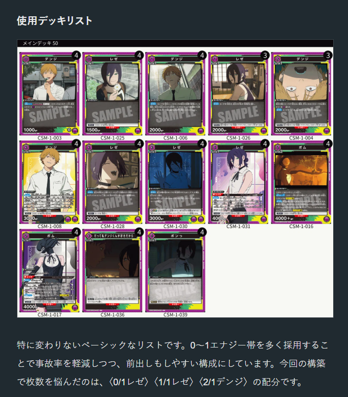

這是一副沒有太多特殊調整的基本構築。透過多放 0～1 能源的卡片，降低卡手率，也讓角色更容易往前排移動。本次構築最讓我猶豫的是〈0/1 蕾潔〉、〈1/1 蕾潔〉、〈2/1 淀治〉的張數分配。

【蕾潔】有豐富的檢索與抽牌手段，不過像〈4/1 蕾潔〉、〈5/1 炸彈〉、〈5/2 炸彈〉等卡片，使用時機不同，能獲得的收益也不同，有時會想先留在手上。因此，我覺得抽牌後棄牌的效果，在手牌較充裕、能挑選要棄掉的卡時，更容易發揮價值。另外，我也想優先利用〈3/1 蕾潔〉的效果讓角色直接登場，維持己方場上的角色數量。

綜合以上考量，具有獲得觸發（Get Trigger）的〈0/1 蕾潔〉評價較高；增加純粹的 0 能源卡張數，也能稍微降低前期能源卡手的機率。最後我採用了 4 張〈0/1 蕾潔〉，以及各 3 張的〈1/1 蕾潔〉與〈2/1 淀治〉。

這終究是個人判斷，少量張數的差異，我認為很大程度取決於個人喜好。

### 對戰結果

原文每場的兩個符號依序對應個人與團隊結果。

| 回合 | 對手牌組 | 個人 | 團隊 |
| --- | --- | --- | --- |
| 第 1 回合 | 藍色【命運石之門】 | 勝 | 勝 |
| 第 2 回合 | 紫色【物語系列】 | 勝 | 敗 |
| 第 3 回合 | 紅色【天元突破】 | 敗 | 勝 |
| 第 4 回合 | 紫色【超時空要塞】 | 勝 | 勝 |
| 第 5 回合 | 黃色【一年級生】 | 敗 | 敗 |
| 第 6 回合 | 紅色【鏈鋸人】 | 勝 | 勝 |

個人成績：4 勝 2 敗。團隊成績：4 勝 2 敗。

譯註：原文結果表將第 5 回合記為【一年級生】，逐場標題則記為【學園偶像大師】，此處保留各自的寫法。

### 第 1 回合｜藍色【命運石之門】

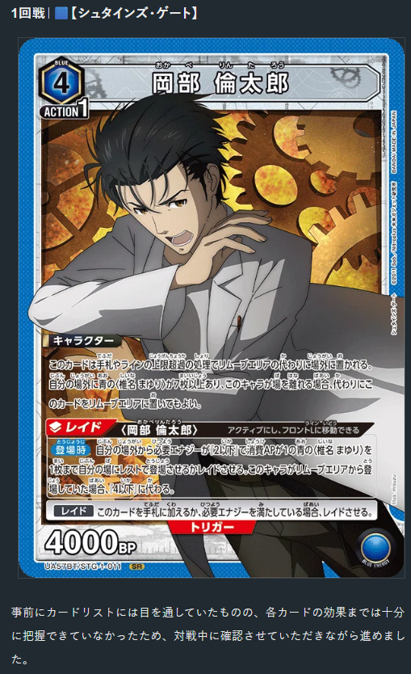

雖然事前看過卡表，卻還沒充分掌握每張卡的效果，因此對戰時一邊向對手確認、一邊進行。

我的印象是，這副牌組利用〈4/1 岡部倫太郎〉的效果，讓 BP4000 的〈椎名真由理〉等角色直接登場。不過，這樣的展開需要一定準備；前期對手一邊讓 BP3000 級別的角色直接登場，一邊反覆操作牌頂及調整手牌。我方則希望趁對手準備完成前，盡可能多打進一些傷害。

【蕾潔】能運用降低 BP 的效果，因此我刻意除去對手的 BP4000 角色，並對 BP3000 角色給予 BP−1000。把 BP3000 降到 BP2000 後，我方〈1/1 淀治〉、〈1/1 蕾潔〉等 BP2000 角色也能成為有效的攻擊手。我的方針不只是處理大型角色，也要創造小型角色能打進傷害的局面，充分運用場上的攻擊次數。

我預計最後靠多個衝擊（Impact）收尾，因此也從這個終點倒推展開，同時注意保留生命值與場面。

這場出現了兩張顏色觸發（Color Trigger），我認為影響也很大。BP2000 角色能攻擊的機會增加，讓小型角色更容易成為有效打點，對推進比賽有很大幫助。

### 第 2 回合｜紫色【物語系列】

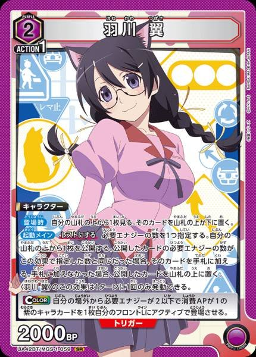

前期就成功用〈5/2 炸彈〉施壓，在生命值競逐中取得領先。我刻意迫使對手處理角色，相對壓縮對手能用來擴張場面的 AP，讓對手被動應對，再接上具有除去效果的〈5/1 炸彈〉，一邊處理對手場面，一邊讓小型角色打進傷害。

對手也有處理小型角色的手段，但其中一部分依賴突襲（Raid），要處理小型角色就需要透過突襲展開。只要再用我方的除去處理那些突襲角色，就能相對於對手花在展開與除去上的 AP，取得有利交換。

此外，前期主要以〈1/1 淀治〉、〈1/1 蕾潔〉等 BP2000 角色進攻。尤其〈1/1 淀治〉即使被處理也能獲得一定收益，因此可以將吃到除去的情況納入考量，積極攻擊對手生命值。

手牌管理方面，我也注意對手的棄手牌效果。如果手上只留下接下來展開必需的卡，被迫棄牌時，後續行動就會大幅受限。因此我會盡量至少留一張即使被棄掉也能接受的卡。

對於〈5/1 黑羽川〉，我的方針是接受她攻擊造成的生命值傷害，盡量降低其他角色帶來的傷害。最後利用前期建立的生命值差距，持續要求對手處理場面，成功獲勝。

### 第 3 回合｜紅色【天元突破】

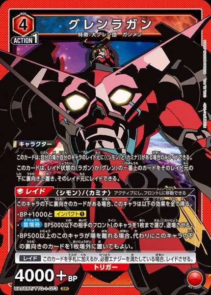

我非常注意用〈5/1 炸彈〉對付〈4/1 紅蓮螺巖〉。因此，原則上會把〈5/1 炸彈〉保留到〈4/1 紅蓮螺巖〉登場，或等到能疊加多個除去效果，一口氣創造多個有效打點時才使用。

實際上，我確實藉由疊加除去創造了多個有效打點，但攻擊被活躍觸發（Active Trigger）及突襲觸發（Raid Trigger）阻擋，沒能削減預期中的生命值。再加上太專注於處理對手角色，我方場面一直只維持最低限度的角色數。

終盤變成必須達成相當苛刻條件才能取勝的局面：先用手上的〈3/1 淀治〉找到〈5/2 炸彈〉，再用〈5/2 炸彈〉讓自己的〈1/1 淀治〉退場，藉由〈1/1 淀治〉的檢索效果找到〈5/1 炸彈〉。如果能全部接上，就有機會靠兩個衝擊收尾。結果雖然找到了〈5/2 炸彈〉，卻沒能用〈1/1 淀治〉檢索到〈5/1 炸彈〉，最後敗北。

這場沒能找到〈3/1 蕾潔〉，也影響了場面建立。不過，更值得反省的是，我太執著於「一定得除去〈4/1 紅蓮螺巖〉」。我原本就知道對手牌組有很多能阻止攻擊的觸發；既然如此，除了追求在單一回合一次創造多個有效打點，也可以選擇從前期就把小型角色移到前排，持續攻擊生命值。

當然，這樣也有小型角色被顏色觸發處理的風險。這次或許把這個風險看得太重了。前期踩到顏色觸發的風險，與無法在生命值競逐中領先、導致終盤取勝條件更苛刻的風險，今後需要比較這兩者，再判斷該在什麼時機嘗試打進傷害。

### 第 4 回合｜紫色【超時空要塞】

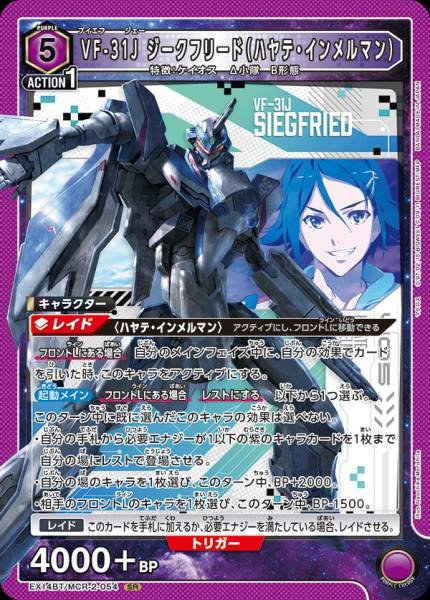

對手在後攻第 3 回合，一口氣突襲了〈5/1 VF-31J 齊格飛（疾風・因梅爾曼）〉、〈4/1 VF-31C 齊格飛（米拉潔・法莉娜・吉納斯）〉、〈5/1 VF-31F 齊格飛（梅薩・伊雷菲爾特）〉。光是這回合就可能損失 4 點生命值，幸好觸發了〈4/1 蕾潔〉，將傷害壓到 3 點。

輪到我方時，使用兩張〈5/1 炸彈〉處理〈5/1 疾風〉與〈4/1 米拉潔〉。處理對手一次展開的場面後，成功奪回節奏。

接著利用〈3/1 蕾潔〉讓角色直接登場的效果擴張場面，用各種 BP4000 角色追趕對手的生命值。

對手也是除去手段很多的牌組，因此雙方場上的角色都變少，後半手牌也有限，局面接近比拚誰能抽到關鍵牌。最後我抽到〈5/1 炸彈〉，順利獲勝。

這場值得反省的，還有我對對手牌組理解不足。由於沒充分掌握【超時空要塞】的卡片效果，因此沒預料到對手後攻第 3 回合的展開。尤其忽略了降低 BP 的除去效果，這點需要反省。

即使對上幾乎初次接觸的牌組，也不能只注意對手的展開能力，還必須理解對手能如何干涉我方場面。

### 第 5 回合｜黃色【學園偶像大師】

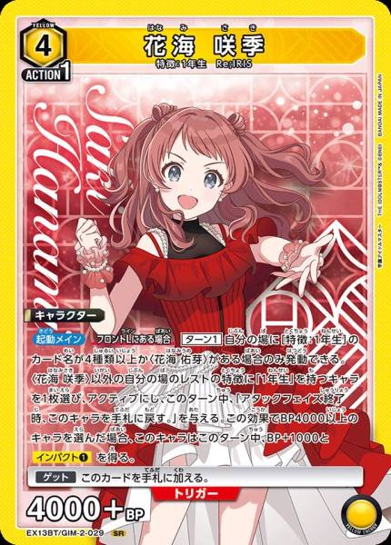

我方以最快速度展開兩張〈5/2 炸彈〉，前期就在生命值競逐中大幅領先。將對手生命值壓到剩下 3 點，比賽原本進行得很順利，但之後接連出現顏色觸發、特殊觸發（Special Trigger）與最終觸發（Final Trigger），攻勢受到很大阻礙。

結果沒能打完對手的生命值，最後被〈4/1 藤田琴音〉配合連續攻擊擊敗。

這場在操作過程中，我想不到什麼特別需要反省的地方。前期已經做出理想展開，這次的結果也只能接受。

### 第 6 回合｜紅色【鏈鋸人】

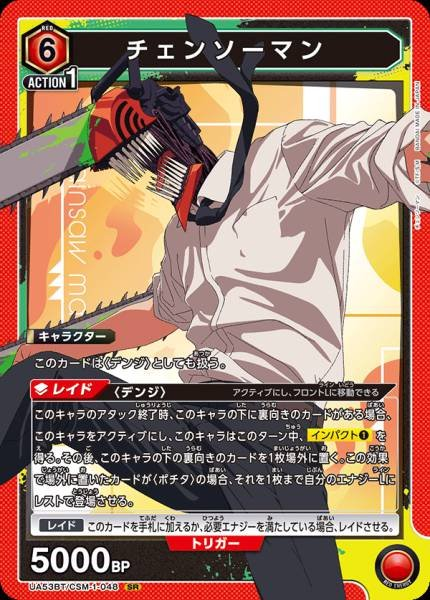

對手先攻第 2 回合就看到了兩張〈0/1 波奇塔〉，因此我決定從這時起接受顏色觸發的風險繼續進行。我方是後攻，即使先展開 BP4000 角色，若被特殊卡（Special）或〈5/1 帕瓦〉處理，後續展開也可能落入被動。因此，我選擇前期積極把小型角色移到前排，攻擊對手生命值。

一邊要求對手處理角色，一邊注意用除去對付對手的 BP4000 角色。最後靠衝擊攻擊獲勝。

### 3on3 結束後

這次 3on3，個人與團隊成績都是 4 勝 2 敗。

經過六回合，我覺得【蕾潔】整體上很少遇到明顯不利的對局，有能力應對各式各樣的牌組。

我特別看重的是，結合降低 BP 效果來創造有效打點，以及依情況靈活選擇除去方式。不只是能處理對手的 BP4000 角色，對 BP3000 角色給予 BP−1000，也能讓〈1/1 淀治〉、〈1/1 蕾潔〉等 BP2000 角色成為有效打點。此外，組合不同的降低 BP 效果，也能處理小型角色，因此能根據對手場面及希望攻擊通過的方式，靈活調整效果的運用，這也是它的優勢。

另一方面，使用〈5/2 炸彈〉或〈5/1 炸彈〉讓自己的角色退場時，必須慎重判斷。若太優先考慮除去與創造打點，我方場面就會變薄，可能導致後續攻擊所需的角色不足。能靠〈3/1 蕾潔〉的直接登場效果補回多少，也是使用這副牌組時必須做出的判斷。

這次對上【天元突破】時，我太優先考慮除去，忽略了場面建立，因此今後也會持續注意這個平衡。

我覺得【蕾潔】比表面上更能因應不同局面。我對牌組選擇沒有後悔，認為這次 3on3 選得很好。

## OBC｜使用牌組【戀次／露琪亞】

繼 3on3 之後，我也參加了 One Battle！

這次使用的是紫色【戀次／露琪亞】。

結果是 4 勝 2 敗。雖然差一步沒能進入前 32 名，但六回合中體驗到了各種對局。

尤其這次連續遇到【戀次／露琪亞】與【一護／露琪亞】，讓我有很多機會思考除去優先順序，以及使用資源的時機。

### 使用牌表

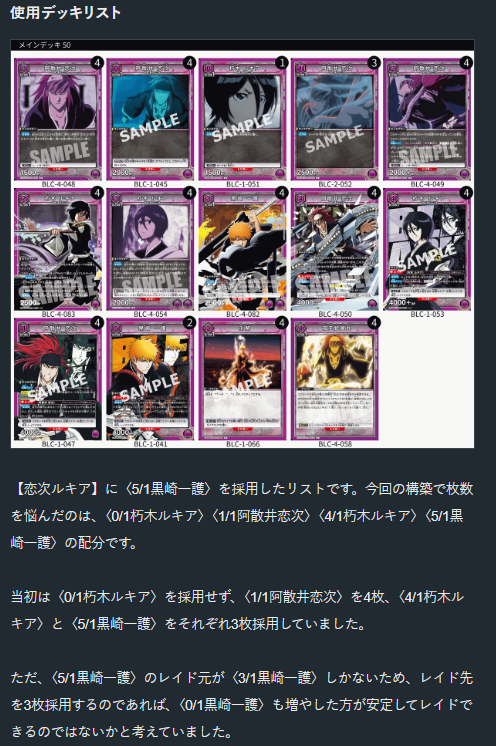

這是在【戀次／露琪亞】中加入〈5/1 黑崎一護〉的構築。這次讓我猶豫張數的是〈0/1 朽木露琪亞〉、〈1/1 阿散井戀次〉、〈4/1 朽木露琪亞〉、〈5/1 黑崎一護〉。

最初我沒有採用〈0/1 朽木露琪亞〉，而是放了 4 張〈1/1 阿散井戀次〉，以及各 3 張的〈4/1 朽木露琪亞〉、〈5/1 黑崎一護〉。

不過，〈5/1 黑崎一護〉的突襲基底只有〈3/1 黑崎一護〉；如果要採用 3 張突襲角色，是否也該增加〈0/1 黑崎一護〉，讓突襲更穩定？我曾這樣考慮。

同時，我也覺得〈朽木露琪亞〉名稱的卡片不足。尤其〈2/1 阿散井戀次〉的主起動效果，需要〈朽木露琪亞〉名稱作為發動條件，因此必須注意場上保留的張數。當然，可以透過場面管理來應對，但若太在意維持名稱，可能連本來能移到前排攻擊的角色，也會選擇留在能源線。如果這些限制會影響操作，我認為不如在構築階段就增加〈朽木露琪亞〉名稱，擴大場面上的選擇。尤其〈2/1 朽木露琪亞〉雖然是優秀的突襲基底，但終盤也有想留在場上，作為賦予不可阻擋能力手段的時候。

綜合以上考量，這次我試著採用了 1 張〈0/1 朽木露琪亞〉。

### 對戰結果

| 回合 | 對手牌組 | 結果 |
| --- | --- | --- |
| 第 1 回合 | 紫色【戀次／露琪亞】 | 勝 |
| 第 2 回合 | 紫色【戀次／露琪亞】 | 敗 |
| 第 3 回合 | 紫色【一護／露琪亞】 | 勝 |
| 第 4 回合 | 紫色【一護／露琪亞】 | 勝 |
| 第 5 回合 | 紫色【朽木白哉】 | 敗 |
| 第 6 回合 | 黃色【星十字騎士團】 | 勝 |

最終成績：4 勝 2 敗。

### 第 1 回合｜紫色【戀次／露琪亞】

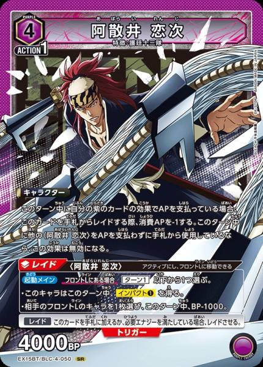

我順暢地用除去處理對手的 BP4000 角色，維持優勢並獲勝。對戰內容方面，想不到什麼特別重大的抉擇或反省點。

順帶一提，對手的【戀次／露琪亞】是全異畫版本，真的超帥！

### 第 2 回合｜紫色【戀次／露琪亞】

因為出現能一次處理對手多個前排角色的時機，我搭配最終卡（Final），展開多個突襲角色，一口氣擴張場面。但對手在下一回合也結合特殊卡與具除去效果的突襲角色，進行多體除去，處理掉我方展開的角色。結果這波交換讓對手奪走節奏，之後持續處於劣勢，最後敗北。

這次的反省點，是投入資源的時機與除去目標的選擇。

同型對局中，雙方處理對手角色所需的資源基本相同，因此能處理掉價值較高角色的一方，更容易獲得較大收益。這次我處理的是非突襲角色。

相對地，對手在下一回合處理的是我方突襲角色。我方消耗多張卡片及 AP 來展開場面，因此被除去時的損失更大，直到最後也沒能追回這個資源差距。

即使能一次處理對手多個前排角色，也不代表一定得在那個時機疊加除去。我應該先比較除去能帶來的收益，以及下一回合可能損失的資源，再判斷要展開幾張角色、是否需要除去。這是本次 One Battle 中，特別值得反省的一場。

### 第 3 回合｜紫色【一護／露琪亞】

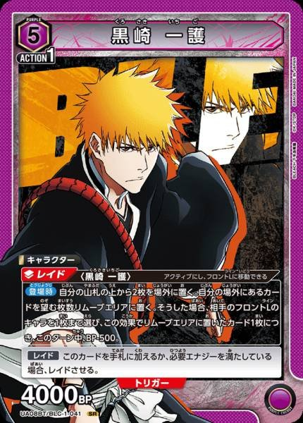

記取上一場一次耗費太多資源的教訓，這次我以徹底管理資源為方針。不試圖處理對手的所有角色，而是挑選除去優先順序高的角色處理。其餘角色則用我方 BP4000 角色施壓，迫使對手犧牲角色阻擋，或讓生命值承受傷害。

在減少除去所需資源的同時，也維持住場面壓力，因此得以一路保持優勢並獲勝。我認為有把第 2 回合的反省直接運用到下一場比賽。

### 第 4 回合｜紫色【一護／露琪亞】

基本上採取與第 3 回合相同的方針，挑選要除去的角色，同時注意維持我方 BP4000 角色。對手沒抽到〈3/1 黑崎一護〉，手牌一直偏少，這點也對我方有利。

我將〈4/1 黑崎一護〉視為優先除去的目標，仔細處理對手場面。趁對手手牌少時維持場面優勢，順利獲勝。

### 第 5 回合｜紫色【朽木白哉】

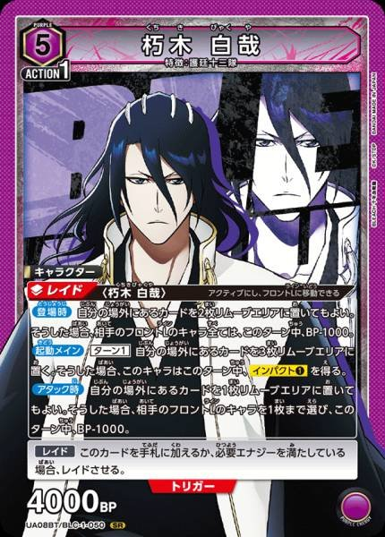

對手有一次除去多個小型角色的手段，因此我以 BP4000 角色為核心建立前排。然而，對手透過特殊卡及〈5/1 黑崎一護〉，順暢地處理我方 BP4000 角色，使我陷入被動。

之後我優先除去〈5/1 朽木白哉〉，並趁對手手牌變少時接連處理場面，成功追平生命值競逐的局勢。但終盤對手透過觸發將〈5/1 朽木白哉〉加入手牌，最後我就這樣輸了。

這次的反省點，是花了太久才辨識出對手的牌組類型。面對【朽木白哉】，我起初主要考慮的是〈5/1 朽木白哉〉與〈4/2 千本櫻景嚴〉的多體除去。但實際上，對手也採用了〈5/1 黑崎一護〉與〈4/1 月牙天衝〉，能處理我方 BP4000 角色的手段，比預想中更多。

我花了太多時間，才從對手採用的卡片判斷出整副牌組的構成，並調整我方的展開方針。結果雖然追上了生命值競逐，但前期到中期應對得太慢，仍值得反省。

### 第 6 回合｜黃色【星十字騎士團】

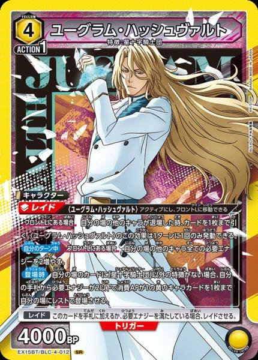

前期便用小型角色積極攻擊生命值，在生命值競逐中取得領先。對手為了應對我方攻擊，將 BP4000 角色展開到前排時，我再接上除去，一口氣掌握節奏。

利用前期建立的生命值差距，以及後續場面優勢，成功獲勝。這場想不到什麼重大的抉擇或反省點。

### OBC 結束後

這次 OBC 的結果是 4 勝 2 敗。

第 2 回合對上【戀次／露琪亞】的同型對局時，我在能除去的時機一次投入資源，結果下一回合受到更大的損失。即使用的是相同除去效果，處理的目標不同，獲得的收益也不同。尤其同型對局中，雙方的除去手段與資源運用相似，更需要比較除去目標的價值，以及下一回合被處理的風險。

第 3、4 回合對上【一護／露琪亞】時，我運用這個教訓，限縮除去目標，維持 BP4000 角色的同時，持續對生命值施壓。

另外，第 5 回合對上【朽木白哉】，也留下了沒能及時依對手牌組類型調整應對的反省。採用的卡片不同，除去手段與展開方式也會改變，因此需要從實際看到的卡片推斷對手構築。

雖然最後沒能進入前 32 名，但這次比賽讓我重新思考資源管理與除去的優先順序。

為了接下來的區域賽，我也想把這次的反省運用到練習中。

## 回顧這次比賽

這次きゅるん盃，3on3 與 OBC 合計打了 12 場。

其中共同感受到的，是要正確評估除去帶來的收益，以及為此消耗的資源，實在很不容易。

3on3 對上【天元突破】時，我太專注於處理對手的重要角色，導致己方場面建立不足。另一方面，OBC 對上【戀次／露琪亞】的同型對局時，雖然靠多次除去與突襲展開，暫時取得場面優勢，卻在下一回合承受更大的損失。這兩場都提醒我，不能只看當下能做的行動有多少價值，也必須考慮後續會留下怎樣的場面與資源。

另外，像這次會遇到各式作品的環境，對對手牌組的理解也有很大影響。3on3 對上【超時空要塞】時，我沒充分掌握對手的展開能力與除去效果；OBC 對上【朽木白哉】時，也花了太久才從採用卡片辨識出牌組類型。今後我想在平時多蒐集各種牌組的資訊，也增加實際交手的機會。

結果兩項都是 4 勝 2 敗。雖然不甘心，但這次有許多重新思考自己操作的機會，是非常好的經驗。

最重要的是，能在與平常略有不同的環境中，和各式各樣的牌組對戰，真的非常開心！

## 最後

感謝這次きゅるん盃與我對戰的各位！也感謝在 3on3 與我並肩作戰的兩位隊友。雖然成績差了一步，但多虧兩位，這次比賽非常愉快！也謝謝當天來向我打招呼的各位！

接下來會以區域賽為目標，將這次的反省運用到練習中！

謝謝大家讀到最後！

### 支持作者

若喜歡這篇文章，可以透過原文頁面的贊助功能支持作者。

標籤：鏈鋸人、UNION ARENA、ユニアリ、BLEACH、牌組解說、比賽報告、きゅるん盃。

作者簡介：大家好，我是さぷり。我撰寫 UNION ARENA 解說文章與比賽報告，也執筆「卡牌遊戲思考學」，從心理學與認知科學分析卡牌遊戲中發生的現象。
